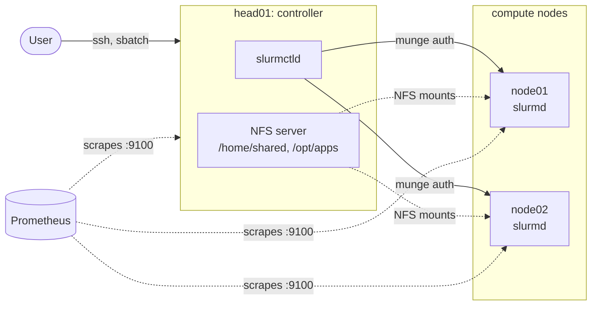

# hpc-cluster-ansible

Ansible playbooks that turn a handful of Rocky Linux 9 machines into a small, working **HPC cluster**: a head node with shared storage and a Slurm controller, and compute nodes that mount that storage and accept jobs.

It is a compact, readable reference of the building blocks I work with in production HPC environments (Slurm, NFS, hardening, monitoring), meant to be run on VMs.

## What it sets up



| Role | Applies to | What it does |
| --- | --- | --- |
| `common` | all nodes | EPEL, base packages, timezone, chrony (NTP), firewalld, users and SSH keys |
| `ssh_hardening` | all nodes | Drop-in `sshd` config: no root login, key-only auth, limited auth attempts, validated before restart |
| `node_exporter` | all nodes | Prometheus node_exporter as a systemd service, port opened in firewalld |
| `nfs_server` | head | Exports shared directories to the cluster network |
| `nfs_client` | compute | Mounts the exports from the head node |
| `slurm` | all nodes | `/etc/hosts` entries, MUNGE key generated once and distributed, `slurm.conf` from the inventory, `slurmctld` on the head and `slurmd` on compute |

## Quick start

Requirements: Ansible 2.15+ and SSH access to the machines (sudo rights).

```bash
git clone https://github.com/lizzfv/hpc-cluster-ansible.git
cd hpc-cluster-ansible
ansible-galaxy collection install -r requirements.yml

# 1. Edit inventory/hosts.yml and inventory/group_vars/all.yml for your hosts
# 2. Run everything
ansible-playbook site.yml

# Or a single part
ansible-playbook site.yml --tags slurm
ansible-playbook site.yml --tags nfs,monitoring
```

Check the result from the head node:

```bash
sinfo                # nodes should be idle
srun -N2 hostname    # runs on both compute nodes
```

### Try it locally with Vagrant

```bash
vagrant up
ansible-playbook -i inventory/vagrant.yml site.yml
```

This creates three VirtualBox VMs (1 head, 2 compute) on a private network `192.168.56.0/24`.

## Configuration

Everything you are likely to change lives in `inventory/group_vars/all.yml`: timezone, NTP servers, users, NFS exports and network, Slurm cluster name, CPUs and memory per node, and partition name.

> **Before enabling key-only SSH** (`ssh_hardening_password_auth: false`, the default), make sure your admin user already has a working key, or you can lock yourself out. The Vagrant inventory leaves password auth on for that reason.

## Quality checks

Every push runs `ansible-playbook --syntax-check` and `ansible-lint` with the strictest `production` profile (see `.github/workflows/lint.yml`). Run the same locally:

```bash
ansible-playbook site.yml --syntax-check
ansible-lint
```

## Scope and limitations

This is a learning/reference project, not a production deployment:

- Slurm accounting (`slurmdbd`), cgroup resource enforcement, GPUs and high availability are not configured.
- Users are local; a real cluster would use LDAP/SSSD.
- The Slurm packages come from EPEL; pin versions for anything beyond a lab.

Ideas for next steps: `slurmdbd` + MariaDB, Lmod/EasyBuild software stack, an Open OnDemand role, Molecule tests.

## License

MIT, see `LICENSE`.

## Running it on VMs (Proxmox or any hypervisor)

Copy `inventory/proxmox/` and put your VM addresses in `hosts.yml`, then:

```bash
ansible-galaxy collection install -r requirements.yml
ansible-playbook -i inventory/proxmox/hosts.yml site.yml --check --diff   # dry run
ansible-playbook -i inventory/proxmox/hosts.yml site.yml
```

The proxmox group_vars keep root SSH login with keys (`prohibit-password`) so you do not lock yourself out.

## Tested on

Three Rocky Linux 9 virtual machines on a Proxmox hypervisor (1 vCPU and about 1.7 GB of RAM each), with `ansible-core` 2.14 running on the head node.
Slurm sees both compute nodes as `idle`, and a two-node `srun` and `sbatch` job runs and writes its output to the shared NFS folder.

Notes from that test:

- Adjust `slurm_node_cpus` and `slurm_node_memory_mb` to what `slurmd -C` reports on your nodes, otherwise Slurm marks them `inval` or `drain`.
- `srun` needs a range of TCP ports open on every node so that job steps can call back (`slurm_srun_port_start` and `slurm_srun_port_end`).
- With `ansible-core` 2.14 use `community.general` below 9 and `ansible.posix` below 2.
